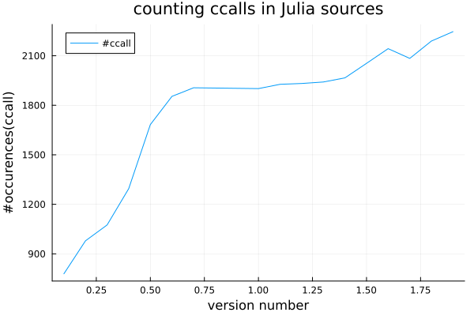

--- 
title: "Interfacer Julia" 
from: markdown+emoji
code-fold: false
author:
  - aitzkora (INRIA Bagnères-de-Bigorre)
jupyter:
  kernelspec:
    display_name: Python 3 (ipykernel)
    language: python
    name: python3
format: 
  revealjs:
    theme: ["nirea.scss"]
    title-slide-attributes:
      data-background-image: fig/pic_midi.jpg
      data-background-size: cover  
---

## plan de l'exposé

- motivations
- le vénérable `ccall`
- utilisations basiques
  - imports multiples
  - gestion de la mémoire 
  - déverminage
  - appels de fonctions
- portabilité
- géneration d'interface 
- langages de haut-niveau : 
  - Python 
  - R 

## motivations

1) Réutiliser tout le code qui marche (BLAS, ODE, LAPACK, etc...)
2) utiliser Julia comme une interface de script à un logiciel écrit en C/Fortran/Rust
3) cas des sources fermées avec une IPA connue
4) Étendre les possibilités du langage

::: {.callout-warning icon=true title="Portée de l'exposé"}
On s'intéresse ici au fait que `Julia` appelle d'autres languages et pas l'inverse. Cependant Julia peut appeler un code qui appelle lui-même Julia
:::

::: {.callout-warning icon=true title="Portabilité"}
certaines choses sont spécifiques à Linux, ou à unsystème POSIX et n'ont pas été testés sous OuïneDoze. La plupart des des éléments du TP peuvent être fait sur Arctic
:::


# le vénérable `ccall`

- Comment appeler une fonction dans une bibliothèque dynamique ?
```{.julia}
ccall((:funcName, library), returnType, (argType1, argType2, ...), (argVal1, argVal2, ...))
```
- utilisation intensive : combien de `ccall` dans les sources de Julia ?

{fig-align="center"}

## `ccall` en C

* Écrivez dans le fichier `skel.c` la fonction 
  ```{.C}
  int ajoute2(int x) { 
     return x+2; 
  }
  ```
  au moyen de $\tt{x}  \in \{\tt{vi}, \tt{emacs}, \tt{nano}\}$
* Compilez le fichier : remarquez `--shared` et `.so` (`.dylib` on OSX :thinking:)
  ```{.bash}
  gcc -o ajoute2.so --shared skel.c
  ```
* Dorénavant, vous pouvez appeler `ajoute2` au moyen de
  ```{.julia}
  w = ccall((:ajoute2, "./ajoute2.so"), Int32, (Int32,), 12) # must return 14
  ```

  + `ajoute2` est un symbole de `ajoute2.so` $\Rightarrow$ `:`
  + Bien utiliser `(Int32,)` et pas `(Int32)` (Tuple)
  + Remplacez `Int32` par  `Int64` or `Float64`.

## Intermède 1
1) bibliothèque dynamique : code chargé dynamiquement à l'exécution 
 - économie de stockage :smile: vs dépendances :neutral_face:
2) bibliothèque statique : code (suite d'instructions) embarqué directement dans l'exécutable  
 - indépendance :smile: vs taille importante :neutral_face:
3) code relogeable  (-fPIC) : adresses relatives pour les fonctions
4) code non-relogeable : adresses absolues pour les fonctions

|                | statique (.a) | dynamique(.so) |
|----------------|----------|-----------|
| relogeable     |    ✔️     |   ✔️         |
| non relogeable |    ✔️     |   ❌      |

## Intermède 2

- Décoration de noms (mangling) : processus d'encodage de noms de symboles dans un binaire
- permet de gèrer des languages non natifs "autre que le C"
  ```{.bash}
  % echo "subroutine f()\n print *, "haha"\n end subroutine" > f1.f90
  % gfortran -c f1.f90
  % nm f1.o
  0000000000000000 T f_
                   U _gfortran_st_write
                   U _gfortran_st_write_done
                   U _gfortran_transfer_real_write
                   U __stack_chk_fail
  ```
- permet la surcharge 
```{.bash}
% echo "int f(int x) { return x+1;}\nfloat f(float x) {return x+1;}" > e1.cpp
% g++ -c e1.cpp && nm e1.o
000000000000000f T _Z1ff
0000000000000000 T _Z1fi
% nm e1.o | c++filt
000000000000000f T f(float)
0000000000000000 T f(int)
```


## `ccall` en Fortran

- Mettez dans le fichier `skel.f90` la sous-routine suivante
  ```{.f90}
  subroutine ajoute2(x, x2)
    integer, intent(in) :: x
    integer, intent(out) :: x2
    x2 = x + 2
  end subroutine ajoute2
  ```
* Compilez le fichier 
  ```{.bash}
  gfortran -o ajoute2.so --shared skel.f90
  ```
- Dorénavant, vous pouvez appeler `ajoute2` au moyen de
  ```{.julia}
  w = Ref{Int32}(0)
  ccall((:ajoute2_, "./ajoute2.so"), Cvoid, (Ref{Int32},Ref{Int32}), Int32(12), w); w[] # returns 14
  ```
  + `:ajoute2_` utilise la décoration de nom (`nm -D ajoute2.so`)
  + :astonished: Fortran passe ses arguments par adresse $\Rightarrow$ `Ref{Int32}`
  - remplacer `Int32` par `Int64` ou `Float64` $\Rightarrow$ Was ist den loss ?

## ccall en c++ 
- Mettez dans le fichier `skel.cpp` la fonction suivante
  ```{.cpp}
  extern "C" {                           
    void ajoute2(const int x, int & y){ 
      y = x+2; 
    }
  }
  ```
* Compilez le fichier 
  ```{.bash}
  g++ -o ajoute2.so --shared skel.cpp
  ```
- Dorénavant, vous pouvez appeler `ajoute2` au moyen de
  ```{.julia}
  w = Ref{Int32}(0)
  ccall((:ajoute2, "./ajoute2.so"), Cvoid, (Int32,Ref{Int32}), Int32(12), w); w[]
  ```
  + on utilise des références pour avoir du vrai C++ 🢣 `Ref{Int32}`
  + on utilise `extern "C"` pour rendre l'appel compatible avec du C
- Pour des projets compliqués 🢣 CxxWrap.jl

## ccall en Rust
- Mettez dans le fichier `ajoute.rs` la fonction suivante
  ```{.rs}
  #[no_mangle]
  pub extern "C" fn ajoute2(a: i64) -> i64 {
          return a+2 
  }
  ```
* Compilez le fichier 
  ```{.bash}
  rustc ajoute.rs --crate-type=cdylib
  ```
- Dorénavant, vous pouvez appeler `ajoute2` au moyen de
  ```{.julia}
  w = ccall((:ajoute2, "./libajoute.so"), Int64, (Int64,), 2)
  ```
  + l'annotation de type en Rust impose les mêmes types
  + on utilise `pub extern "C"` pour rendre l'appel compatible avec du C

# tableaux (C)
- considérons le code suivant
  ```{.c}
  #include <inttypes.h>
  double mysum(int64_t m, int64_t n, double *x) {
    double s = 0.;
    for(int64_t i = 0; i < m; ++i)
      for(int64_t j = 0; j < n; ++j) 
        s += x[i * n + j];
    return s;
  }
  ```
- on va le nourrir en Julia avec une matrice
  ```{.julia}
  a = reshape(collect(1.:10.), 5, 2)
  s = ccall((:mysum, "./mysum.so"), Float64, (Int64, Int64, Ptr{Float64}), size(a, 1), size(a, 2), a); 
  println(s)  # renvoie 55.0 
  ```
- Pour importer une matrice de type `T`, on utilise `Ptr{T}`

## tableaux (Fortran)
- soit le code
  ```{.f90}
  subroutine mysum(m,n,x,s)
    use iso_c_binding
    integer(c_int64_t), intent(in), value :: m,n
    real(c_double)    , intent(in) :: x(m,n) ! testez avec x(:,:) 
    real(c_double)    , intent(out):: s
    s = sum(x)
  end subroutine
  ```
- appel en Julia

  ```{.julia}
  a = reshape(collect(1.:10.), 5, 2)
  s = Ref(0.0)
  ccall((:mysum_, "./mysumf.so"), Cvoid, (Int64, Int64, Ptr{Float64}, Ref{Float64}), size(a, 1), size(a, 2), a, s); 
  println(s[])  # renvoie 55.0 
  ```
- Remarques : 
  - utilisation de `iso_c_binding` 🢣 `c_double`, `int_64_t`
  - qualificateur `value` 🢣 pas besoin de réference
  - attention ne marche pas avec `x(:,:)` (assumed-shape arrays)

# imports multiples
- Soit la mini-bibliothèque d'allocations suivante
 ```{.C filename="alloc.c"}
 #define ALLOC_MAX 4
 double *table[ALLOC_MAX];
 int64_t compteur = 0;
 int64_t my_alloc(int64_t size) {...}
 void my_free(int64_t num) {...}
 int64_t set_values(int64_t size, int64_t num, double * val) {...}
 int64_t get_values(int64_t size, int64_t num, double * val) {...}
 ```
- après la compilation `gcc -fPIC --shared -o liballoc.so alloc.c`
 ```{.bash filename="nm -D liballoc.so"}
  0000000000004060 B compteur
  0000000000001250 T get_values
  0000000000001129 T my_alloc
  00000000000011a6 T my_free
  00000000000011f3 T set_values
  0000000000004040 B table
  ``` 

## `dlopen` et `dlsym`
- Grâce à l'appel système `dlsym`, on peut associer une adresse à un symbole
  ```{.julia filename="alloc_table.jl" code-fold="true"}
  using Libdl: dlopen, dlsym
  lib_alloc = dlopen("./liballoc.so")
  all_ptr, fre_ptr, set_ptr, get_ptr = map(x->dlsym(lib_alloc, x), [:my_alloc, :my_free, :set_values, :get_values])
  
  function alloc(n::Int)
      ret = ccall(all_ptr, Int64, (Int64, ), n)
  end
  ``` 
::: {.callout-warning collapse=true icon=true} 
valable sur les systèmes POSIX 🢣 pas de compatibilité garantie avec les DLLs windows
- À vous de jouer : 
  - ajouter les `ccall` pour `set_values`, `get_values`, `my_free` dans `alloc.jl`
  - à l'aide de cette mini-IPA : allouer une zone mémoire, écrire dedans et récupèrer les valeurs
  - note : une version Fortran `alloc.f90` est aussi disponible pour les ceusses qui veulent


## Libc
- La bibliothèque standard du C est présente par défaut en Julia sous le nom `Libc`. On peut
  donc l'appeler directement comme dans les appels suivants
```{.Julia filename="rand"}
julia> Float64(convert(Cint,Libc.rand())/2147483647)
0.6183668312702173
```

```{.julia filename="printf"}
julia> ccall(:printf, Cvoid, (Cstring,), "hoho\n")
hoho
```

# Gestion de la mémoire 
- On peut exposer de la mémoire allouée coté C/Fortran directement en Julia grâce à

::: {.callout-note icon=true title='unsage_wrap'}
`unsafe_wrap(Array, pointer::Ptr{T}, dims; own = false)`

Wrap a Julia Array object around the data at the address given by pointer, without making a copy. The pointer element type T determines the array element
type. `dims` is either an integer (for a 1d array) or a tuple of the array dimensions. own optionally specifies whether Julia should take ownership of the
memory, calling free on the pointer when the array is no longer referenced.
:::

- À vous de jouer : réécrire `alloc.c` et `alloc.jl` pour renvoyer directement des tableaux en Julia, plus besoin de `get_values` et `set_values`

## gestion de la mémoire 
- On dispose d'autres fonctions pour gérer la mémoire
  - `pointer(x)` : recupère l'adresse d'un objet
  - `unsafe_store!(p, val, ind)` 🢣 `p[ind] = val`
  - `unsafe_load(p, ind)` : renvoies `p[ind]`
- exemple
```{.bash}
julia> z = unsafe_wrap(Array, convert(Ptr{Int32},Libc.calloc(3, 4)), (1,3))
1×3 Matrix{Int32}:
 0  0  0

julia> z[1:2] = [3, 2];

julia> unsafe_load(pointer(z), 1)
3

julia> unsafe_store!(pointer(z), 1, 3)
Ptr{Int32} @0x0000000034420660

julia> z
1×3 Matrix{Int32}:
 3  2  1
```

# déverminage : *a la Mac Gyver* 
::: {.callout-warning icon=true title='Ajouter `printf/print` dans le code'}
```{.C filename="truc.c"}
#include <stdio.h>
void truc(int * x) { *x += 2; printf("%d\n", x); }
```

```{.julia filename="truc.jl"}
z= Ref(Int32(0.0))
ccall((:truc, "./libtruc.so"), Cvoid, (Ref{Int32},), z) # 🫠 : pas d'affichage
```
car `stdout` est inaccessible
:::

::: {.callout-tip icon=true title='passer un descripteur de fichier'}
```{.C filename="truc_desc.c"}
#include <stdio.h>
void truc(int * x, FILE * fp) { *x += 2; fprintf(fp, "%d\n", x); }
```

```{.julia filename="truc_desc.jl"}
z= Ref(Int32(0.0))
ccall((:truc, "./libtruc_desc.so"), Cvoid, (Ref{Int32}, Ptr{Cvoid}), z, Libc.FILE(Libc.RawFD(1), "w") ) # 👍
```
:::

## déverminage : GDB
- On recompile `truc.c` avec les symboles de déverminage (`-g`)
```{.bash title="recompile avec -g"}
gcc --shared -o libtruc.so -g truc.c
```
- on lance ensuite `GNU gdb`
```{.gdb}
(gdb) file julia
(gdb) set args -L truc.jl
(gdb) set breakpoint pending on
(gdb) b truc
❌️ Function "truc" not defined.
Breakpoint 1 (truc) pending.
(gdb) run
(...)
Enable debuginfod for this session? (y or [n]) n
Thread 1 "julia" hit Breakpoint 1, truc (x=0x7fffed2431a0) at truc.c:3
3	  *x += 2;
(gdb) p *x
$1 = 0
(gdb) n
4	  printf("%d", x);
(gdb) p *x
$2 = 2
```
- on peut aussi faire `gdb -p $(pgrep julia)` mais il faut désactiver `/proc/sys/kernel/yama/ptrace_scope`

# appel de fonctions Julia (C)
- `@cfunction` génère une un pointeur de fonction appelable depuis le C/Fortran
- exemple 
```{.C filename="apply_f.c"}
#include <inttypes.h>
double apply_f(double (*fun)(double), int64_t x_n , double *x, double * y) {
  for(int64_t i = 0; i < x_n; ++i)
      i[y] = (*fun)(i[x]);
}
```

```{.julia filename="apply_f.jl"}
a = collect(1.:10.)
fun = @cfunction(x->x*x, Float64, (Float64,))
b = zeros(10)
s = ccall((:apply_f, "libjuliafun.so"), Cvoid, (Ptr{Cvoid}, Cint, Ptr{Cdouble}, Ptr{Cdouble}), fun, 10, a, b)
println("b = $b")
```
 
## exercice :
- Écrire une fonction C/Fortran et son appel en Julia qui prend en arguments 
   - un vecteur $v$ de `Float64`
   - une valeur initiale $c_0$
   - un opérateur binaire $op$
   - une fonction unaire $f$ 
- et qui calcule $$op(op(op(c_0, f(v[1]), f(v[2]), ..., f(v[end]))))$$
- et vérifier que pour le 4-uplet $([1.:10;],0,+,.²)$ on obtient bien 385.0!

# Et la portabilité, diable !

- hypothèse du TP : système POSIX avec outils GNU
- Comment généralise-t-on à d'autres OS/compilos ? :thinking:
- Faciliter le déploiement
- écosystème binaire de Julia : 
  - [BinaryBuilder.jl](https://binarybuilder.org/) : paquet de compilation croisée
  - RootFS : systeme basé sur une image docker Alpine 
  - [JuliaBinaryWrappers](https://github.com/JuliaBinaryWrappers/) : autogénération de paquets binaires du genre `mon_paquet_jll.jl`
  - [Yggdrasil](https://github.com/JuliaPackaging/Yggdrasil) : forge de compilation binaire


## schéma générique

{fig-align="center", width=400}

## BinaryBuilder.jl
1) cours magicien, cours! :wink: 
   ```{.bash}
   julia> using BinaryBuilder
   julia> BinaryBuilder.run_wizard()
   
       o      `.
      o*o      \'-_               00000000: 01111111  .
        \\      \;"".     ,;.--*  00000001: 01000101  E
         \\     ,\''--.--'/       00000002: 01001100  L
         :=\--<' `""  _   |       00000003: 01000110  F
         ||\\     `" / ''--       00000004: 00000010  .
         `/_\\,-|    |            00000005: 00000001  .
             \\/     L
              \\ ,'   \
            _/ L'   `  \          Join us in the #binarybuilder channel on the
           /  /    /   /          community slack: https://julialang.org/slack/
          /  /    |    \
         "_''--_-''---__=;        https://github.com/JuliaPackaging/BinaryBuilder.jl
   
   (...)
   ```
   - télécharge les compilos et préconfigure certaines choses
   - :hand: prend énornément de place !
2) ou partir d'un `build_tarballs.jl` et l'adapter *a la mano*

## exemple de `build_tarballs.jl` 

```{.julia}
using BinaryBuilder
name = "libfoo"
version = v"1.0.1"
sources = [
    ArchiveSource("<url to source tarball>", "sha256 hash"),
]

script = raw"""
cd ${WORKSPACE}/srcdir/libfoo-*
make -j${nproc}
make install
"""

platforms = supported_platforms()

products = [
    LibraryProduct("libfoo", :libfoo),
    ExecutableProduct("fooifier", :fooifier),
]

dependencies = [ Dependency("Zlib_jll"), ] 
build_tarballs(ARGS, name, version, sources, script, platforms, products, dependencies)
```

## éléments du `build_tarballs.jl`

1) `sources` : origine des sources
   ```{.julia}
   sources = [ GitSource("https://gitlab.inria.fr/fuentes/n2qn1.git", 
   "a3b6c2cf8d429591976f5e33c0c9766b1e8fea05") ]
   ```
   peut être du type `GitSource`, `ArchiveSource`, `DirectorySource` ou `FileSource`
2) `script` : chaîne multilignes contenant le script de compilation. Fait souvent appel à `Make` ou `CMake`
3) `platforms` : tableaux des plateformes cibles de compilation. Disponible à l'aide de `supported_platforms`
4) `products` : résultats de compils, à archiver dans le paquet binaire. La plupart du temps des bibliothèques
5) `dependencies` : autres paquets Julia dont on peut dépendre


## exercice : recette pour alloc

1) copier `alloc.c` et/ou  `alloc.f90` dans un sous-repertoire
2) `sources` $\Rightarrow$ utiliser `DirectorySource` sur le sous-répertoire
3) ajouter dans le sous répertoire le `CMakeLists.txt` suivant
   ```{.cmake}
   cmake_minimum_required(VERSION 3.17)
   project(libAlloc LANGUAGES Fortran C)
   add_library(alloc SHARED alloc.c)
   add_library(alloc_f SHARED alloc.f90)
   install(TARGETS alloc_f alloc)
   ```
4) `script` : utiliser le script suivant 
   ```{.julia}
   script = raw"""
   cd ${WORKSPACE}/srcdir/
   cmake -B build -DCMAKE_INSTALL_PREFIX=${prefix} -DCMAKE_TOOLCHAIN_FILE=${CMAKE_TARGET_TOOLCHAIN} \
                  -DCMAKE_BUILD_TYPE=Release
   cmake --build build 
   cmake --install build
   install_license ${WORKSPACE}/srcdir/LICENSE
   """
   ```
5) ajouter un fichier de licence dans le sous-répertoire

## Exercice (suite)

5) `platforms` : se limiter à linux avec `libc="glibc"` et utiliser

6) `products` : selectionner `liballoc` et/ou `liballoc_f`

7) `dependencies` : commencer par des dépendances vides `=[]` et rajouter
la dépendance suggerée par Julia

8) lancer la compil avec  `julia build_tarballs.jl --deploy=local`

::: {.callout-warning icon=true title='Avis à la population'}
N'essayer pas sur Arctic, vous manqueriez de privilèges spéciaux pour utiliser RootFs
:::

::: {.callout-tip icon=true title='copier une recette'}
Vous pouvez vous inspirer de la recette pour [N2QN1](https://github.com/JuliaPackaging/Yggdrasil/blob/master/N/N2QN1/build_tarballs.jl)
:::

9) Pour les téméraires : remplacer l'appel à CMake par un appel direct a Make

# [Clang.jl](https://github.com/JuliaInterop/Clang.jl)

- Clang en tant que compilateur possède un analyseur syntaxique avec une API
- Clang.jl l'utilise pour générer des interfaces
- exemple : `MPI.jl` contient un fichier MPIGenerator.jl
  ```{.julia}
  (...)
  signatures() = begin
    (...)
    include_dir = normpath(artifact_dir, "include")
    args = vcat(get_default_args(), "-I$include_dir")  # add compiler flags
    headers = if MPIPreferences.binary == "MPICH_jll"
        push!(args, "-include$include_dir/mpi.h")
        joinpath(include_dir, "mpi_proto.h")
    elseif MPIPreferences.binary == "OpenMPI_jll"
        joinpath(include_dir, "mpi.h")
    end
    ctx = create_context(headers, args, options)
    build!(ctx)  # run generator
  ```

## exercice : interface de `alloc.c`

 1) écrire `alloc.h` à partir de `alloc.c` (retenir les declarations)
 2) créer un fichier `generator.toml`
    ```{.toml}
    [general]
    library_name = "liballoc"
    output_file_path = "./Liballoc.jl"
    module_name = "Liballoc"
    ```
 3) créer le script  `generator.jl`
   ```{.julia}
   using Clang.Generators
   cd(@__DIR__)
   include_dir = pwd() # ou le chemin absolu, nahi duzuen bezala !
   options = load_options(joinpath(@__DIR__, "generator.toml"))
   args = get_default_args() 
   push!(args, "-I$include_dir")
   headers = [ joinpath(include_dir, "alloc.h")]
   ctx = create_context(headers, args, options)
   build!(ctx)
   ```
 4) exécuter `generator.jl`
 5) comparer le résultat avec votre fichier d'interface précédent

# appeler du  Python
- `PyCall.jl` : permey d'appeler directement du Python
- exemple : `PyPlot.jl` utilise `PyCall.jl`
- import d'un symbole Python au moyen de `@pyimport` 
  ```{.julia}
  julia> using PyCall
  julia> @pyimport numpy
  julia> a = transpose(numpy.arange(5))
  1×5 transpose(::Vector{Int64}) with eltype Int64:
   0  1  2  3  4
  ```
- configuration
  
  ::: {.callout-tip icon=true title='Config : choisir son Python'}

  ```{.julia}
  ENV["PYTHON"] = "... path of the python executable ..."
  using Pkg
  Pkg.build("PyCall")
  ``` 
  :::

## exemple avec VTK
- on souhaite lire le maillage VTK non-structuré suivant
  ```{.bash}
  % cat twoTriangles.vtk
  # vtk DataFile Version 1.0
  two triangles
  ASCII
  DATASET UNSTRUCTURED_GRID
  POINTS 4 double
  0. 0. 0.
  0. 1. 0.
  1. 1. 0.
  1. 0. 0.
  CELLS 2 8
  3 0 1 3
  3 1 2 3
  CELL_TYPES 2
  5
  5
  ```
- afin de le stocker dans la structure
  ```{.julia}
  struct Mesh
      points::Matrix{Float64}
      cells::Vector{Vector{Int32}}
  end
  ```

## python : exemple 2
- l'interface Python de vtk utilise un "pipeline" représenté sous la forme d'un dictionnaire
 ```{.julia}
  using PyCall
  @pyimport vtk
  function readMeshFromFileVtk(fileName::String)
      reader=vtk.vtkUnstructuredGridReader()
      reader["SetFileName"](fileName)
      reader["Update"]()
      out = reader[:GetOutput]()
      pts = out[:GetPoints]()
      pointsData = pts[:GetData]()
      clls = out[:GetCells]()
      cllData = clls[:GetData]()
      nbCells = out[:GetNumberOfCells]()
      i=1 
      cellIdx = 1
      cells = fill(Int32[], nbCells) 
      while i < length(cllData)
           currentCellSize = cllData[i]
           cells[cellIdx] = cllData[i+1:i+currentCellSize]
           i += currentCellSize+1
           cellIdx += 1
      end
      return Mesh(pointsData, cells)
  end
  ```
- testé avec VTK-9.6.2-7 sur Arch Linux

# pour ne pas manquer d'R 😮‍💨
- `RCall.jl` permet d'appeler du R depuis Julia
  ```{.julia}
  julia> using RCall

  julia> n_ju = rcopy(R"""rnorm($((x->x*x).(1:10)))"""); n_ju'
  1×10 adjoint(::Vector{Float64}) with eltype Float64:
   -0.831815  1.17597  -0.152008  0.552661  0.727258  1.10984  -0.00164307  0.343077  0.475315  -1.55768
  ```
- Explications :
  - `R"""ma_chaîne_en_R"""` renvoies un objet R
  - `rcopy(obj)` convertit en copiant `obj` en Julia
  - `$` à l'intérieur de permet d'appeler du code Julia (interpolation)

## appel R (suite) 
- Choisir son interprète : si vous n'aimez pas  Conda (comme moi :angry:)
  
  ::: {.callout-tip icon=true title='Configurer RCall'}

  ```{.julia}
  ENV["R_HOME"] = "/path/vers/lib/R/" # donc /path/vers/lib/R/bin/R est l'executable!
  using Pkg
  Pkg.build("RCall")
  ``` 
  :::

- import de data frame R
```{.julia}
julia> df_ju = rcopy(reval("iris"))
150×5 DataFrame
 Row │ Sepal_Length  Sepal_Width  Petal_Length  Petal_Width  Species
     │ Float64       Float64      Float64       Float64      Cat…
─────┼─────────────────────────────────────────────────────────────────
   1 │          5.1          3.5           1.4          0.2  setosa
   2 │          4.9          3.0           1.4          0.2  setosa
   3 │          4.7          3.2           1.3          0.2  setosa
   4 │          4.6          3.1           1.5          0.2  setosa
   5 │          5.0          3.6           1.4          0.2  setosa
  ⋮ │      ⋮             ⋮            ⋮             ⋮           ⋮
 141 │          6.7          3.1           5.6          2.4  virginica
 142 │          6.9          3.1           5.1          2.3  virginica
``` 

# conclusion 
- interfaçage simple avec C/Fortran pour des types élémentaires
- outils de portabilité 🢣 [BinaryBuilder.jl](https://binarybuilder.org/)
- proposez votre logiciel à [Yggdrasil](https://github.com/JuliaPackaging/Yggdrasil/) en faisant une demande d'ajout
- cherchez de l'info sur [JuliaInterop](https://github.com/JuliaInterop)
- posez des questions sur [Julia discourse](https://discourse.julialang.org/)
